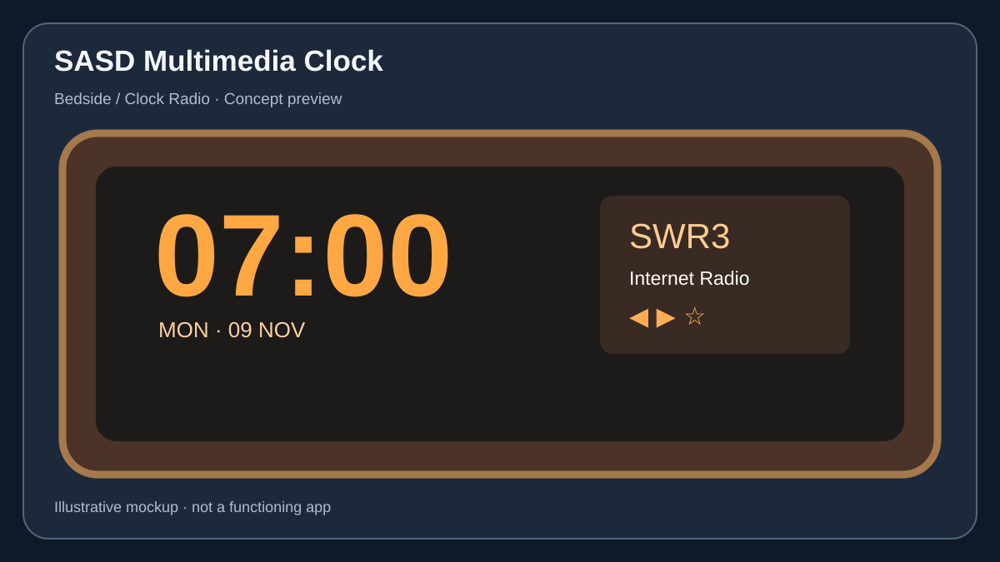
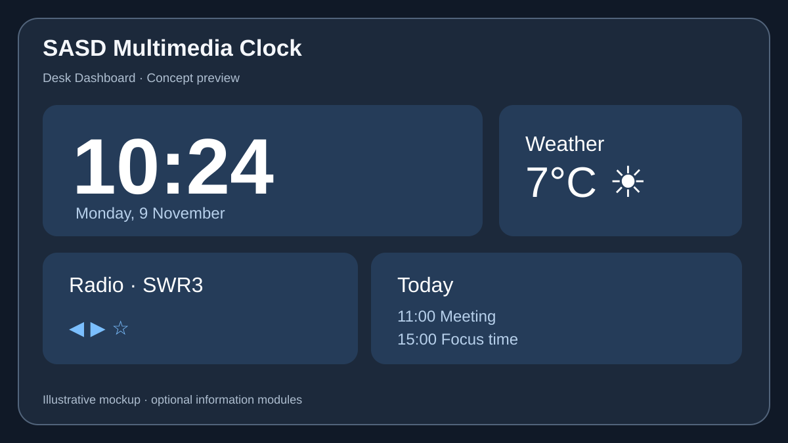

# SASD Multimedia Clock

**Give your old iPhone or iPad a new purpose.**

SASD Multimedia Clock is a planned, customizable clock, alarm radio, media player and information dashboard for iPhone and iPad. Its central goal is to extend the useful life of older Apple devices by turning them into attractive bedside clocks, desk companions and multimedia stations.

> **Project status: specification / concept (pre-alpha).** The screens below are design mockups, not screenshots of a working application. Features described here are proposed requirements, not completed implementations. No production-ready alarm functionality is available yet.

## Contents
- [Vision](#vision)
- [Design previews](#design-previews)
- [Use cases](#use-cases)
- [Planned features](#planned-features)
- [Media sources](#media-sources)
- [Alarm reliability and iOS limitations](#alarm-reliability-and-ios-limitations)
- [Supported devices](#supported-devices)
- [Technical direction](#technical-direction)
- [Roadmap](#roadmap)
- [Privacy, accessibility and sustainability](#privacy-accessibility-and-sustainability)
- [Development](#development)
- [Contributing](#contributing)
- [License](#license)

## Vision

A traditional clock radio was easy to understand: it displayed the time, played your favorite station and woke you up. SASD Multimedia Clock reimagines that experience for modern devices, without abandoning simplicity.

**Product principles**
1. **Reuse before replacement:** older iPhones and iPads are first-class target devices.
2. **One app, multiple uses:** bedside, desk and multimedia dashboard are configurable profiles, not separate products.
3. **Make it yours:** interchangeable, configurable skins inspired by classic customizable media players.
4. **Local-first:** no mandatory account or cloud service for core functionality.
5. **Modular:** optional capabilities such as sleep assistance are disabled until explicitly enabled.
6. **Honest reliability:** never promise background video playback or alarm behavior that iOS cannot guarantee.

## Design previews

The project currently has three visual concepts: a vintage clock radio, an iPad settings interface and a desktop-style dashboard. The preview illustrations below are **concept artwork**, not functional app screenshots.

### Bedside / classic clock radio



A large, legible clock, station presets, playback controls, volume and optional night behavior.

### Configuration on iPad


A native-feeling settings hierarchy with usage profiles, appearance, media sources, alarms, device behavior and privacy.

### Desk dashboard



A modular view with time, radio, agenda, weather, world clocks and optional widgets. Integrations shown in concept art do not imply they are implemented.

> High-resolution exploratory PNG mockups were produced during product discovery. They should be added to the repository under `docs/images/mockups/` after asset review; the SVGs here are lightweight repository-native previews.

## Use cases

| Profile | Typical use | Primary modules |
| --- | --- | --- |
| **Bedside** | Reuse an old phone as a clock radio | Clock, alarms, radio, dimming |
| **Desk** | Keep an iPad visible during work | Clock, media, calendar, weather, timers |
| **Multimedia** | Schedule playback and display media | Audio/video, sources, routines |
| **Custom** | Assemble a personal layout | Any enabled modules |

Profiles provide starting configurations. Users should be able to adjust, duplicate and switch them without losing settings.

## Planned features

The following is a **product backlog**, not a list of implemented capabilities.

### Clock and appearance
- Digital and analog clocks, 12/24-hour format, optional seconds and date.
- High-contrast, large-type and night-friendly display modes.
- Portrait and landscape layouts, adaptive iPhone/iPad interfaces.
- User-selectable skins (retro LED, flip clock, minimalist, classic radio, etc.).
- Declarative skin definitions with validation and safe fallback.
- Screen burn-in mitigation and resource-conscious always-on usage where supported.

### Alarms and timers
- Multiple named alarms, weekday schedules, snooze and dismiss actions.
- Clear indication of notification permissions and alarm delivery limitations.
- Local fallback sounds for network-dependent wake-up scenarios.
- Countdown, stopwatch and optional focus/Pomodoro timers.
- Testable behavior across lock screen, app suspension, offline mode and device restart.

### Radio, music and podcasts
- Direct HTTP(S) audio streams and compatible playlist/stream formats.
- Station favorites, stream validation, reconnect behavior and playback diagnostics.
- Local audio files and supported music-library access.
- Podcast feeds, episode selection and optional downloaded episodes.
- Sleep timer and volume fading where permitted by the platform.

### Video and scheduled routines
- Playback of supported local and URL-based video sources.
- User-configured time-triggered actions while the app is active.
- Optional morning routines combining alarm, display, audio and video.
- Clear capability checks for DRM, authentication, autoplay and background restrictions.
- No promise of automatic playback of arbitrary TV shows from a locked device.

### Optional modules
- **Sleep assistance:** opt-in only; never automatically started merely because the module is enabled.
- Weather, calendar, reminders and world clocks.
- Home automation integrations and extensible media-source providers.
- Import/export of profiles and skins.

## Media sources

The intended source model is **URL-first, not radio-station-first**. Example of a direct internet radio stream:

```text
https://liveradio.swr.de/sw282p3/swr3/play.mp3
```

A URL is not automatically playable: redirects, codecs, TLS, authentication, content type, playlists, DRM, rights restrictions and network conditions all matter. An ordinary webpage containing a video player is not equivalent to a direct media URL. Streaming-service integrations require supported APIs and compliance with provider terms.

Offline operation applies to **locally available and authorized content**. Live radio and most remote video require a network connection. Downloaded podcasts and some library media may be available offline depending on source and rights.

## Alarm reliability and iOS limitations

**This is a critical engineering and safety requirement.**

An iOS app cannot generally wake itself from arbitrary suspended or terminated states, unlock the device and start an arbitrary internet stream or TV show at a precise time. Local notifications are not a full substitute for a system alarm. Newer Apple alarm APIs may offer additional capabilities on supported OS versions, but those capabilities must be tested and feature-gated.

The planned design separates:
- **Alarm delivery:** the most reliable OS-supported mechanism available on the device.
- **Media routines:** optional playback actions that run only when platform conditions allow.
- **Fallback behavior:** a local alert and clear error reporting when network playback fails.

**Until device testing proves otherwise, do not rely on this project as your only alarm clock.**

## Supported devices

**Initial targets:** iPhone and iPad.

**Proposed minimum:** iOS / iPadOS **16.0**, subject to compatibility and performance validation. Supporting older hardware is a deliberate product goal, not an incidental benefit.

The build environment must use an Xcode version accepted for current App Store submissions; the deployment target is independent of the Xcode host OS version. A legacy Intel Mac with Big Sur may be useful for early experiments but is not assumed sufficient for current distribution.

**Future candidates:** Android, Windows, Linux and macOS. These are not current release commitments.

## Technical direction

The initial implementation is intended to be **native Swift + SwiftUI**, using Apple media and notification frameworks as appropriate. A reusable C++20 core is an architectural option, **not** a prerequisite for the first release.

Proposed logical modules:

```text
SASD Multimedia Clock
├── App / SwiftUI
│   ├── Profiles & Navigation
│   ├── Clock Views & Skin Renderer
│   ├── Settings & Accessibility
│   └── Platform Integration
├── Domain
│   ├── Clock & Time
│   ├── Alarm Definitions
│   ├── Scheduled Routines
│   └── Configuration
├── Media
│   ├── Source Catalog & URL Resolver
│   ├── Audio / Video Player Coordinator
│   ├── Favorites & Playlists
│   └── Playback Diagnostics
└── Optional Modules
    ├── Sleep Assistance
    ├── Calendar & Weather
    └── Integrations
```

Interfaces should isolate platform-specific playback, scheduling and persistence. Never infer that a feature is available solely because its configuration is present.

## Roadmap

| Stage | Intended outcome | Status |
| --- | --- | --- |
| **P0 – Feasibility** | Verify iOS 16 deployment, stream playback, alarm limitations, iPhone/iPad layouts | Planned |
| **M1 – Foundation** | Native app shell, settings, profiles, clock | Planned |
| **M2 – Media** | URL audio, local media, favorites, error handling | Planned |
| **M3 – Alarm** | Platform-appropriate alarm flows, permission UX, failure testing | Planned |
| **M4 – Appearance** | Skin format, renderer, bundled skins | Planned |
| **M5 – Multimedia** | Supported video sources and active-app routines | Planned |
| **M6 – Quality** | Accessibility, older-device endurance, privacy and release validation | Planned |

Release scope and sequencing may change after P0. In particular, streaming-service integration and fully automatic TV playback are **research topics**, not guaranteed V1 deliverables.

## Privacy, accessibility and sustainability

- No mandatory registration for basic clock and locally configured media use.
- Local storage by default; explicit consent for optional integrations.
- Avoid unnecessary analytics, tracking and background network activity.
- Support Dynamic Type where appropriate, VoiceOver, high contrast and large touch targets.
- Design for older devices: modest memory/CPU usage, efficient rendering and battery-aware behavior.
- Provide user-controlled night dimming and practical guidance for long-term charging and display wear.
- Distinguish internet-connected legacy devices from devices still receiving security updates.

## Development

**Current state:** design and requirements work. There is no verified buildable Xcode application in this repository yet.

Once the initial project is committed, development instructions will document:
1. Required macOS and Xcode versions.
2. Simulator and physical-device test matrix (including iOS 16).
3. Project structure, build and test commands.
4. Signing and deployment procedures.
5. Media-stream test fixtures and reproducible alarm test cases.

Please do not assume that cloning this repository currently yields a runnable app.

## Contributing

Ideas, bug reports, platform compatibility observations and implementation proposals are welcome. Before large contributions, discuss the intended scope and preserve the project's core goals: older-device support, user control, modularity and honest platform behavior.

Useful contributions include accessibility reviews, verified stream-format tests, skin concepts, battery/endurance measurements and iOS alarm behavior experiments.

## License

**License to be determined.** Public repository visibility does not by itself grant an open-source license. Do not assume redistribution or reuse rights until a license file is added.

---

*Project: SASD Multimedia Clock · Documentation language: English · Status: pre-alpha concept.*
